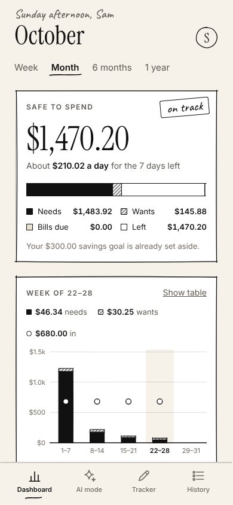
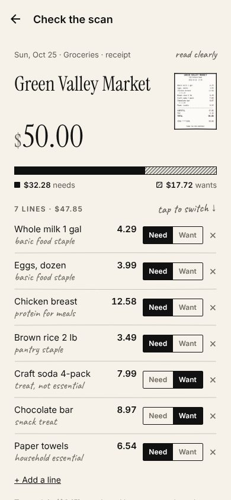
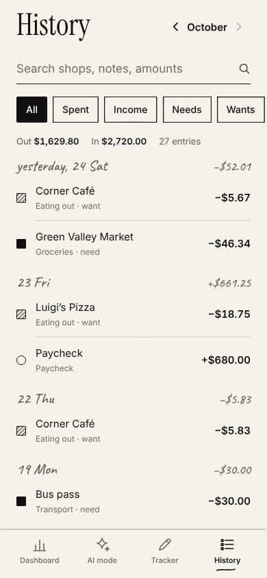
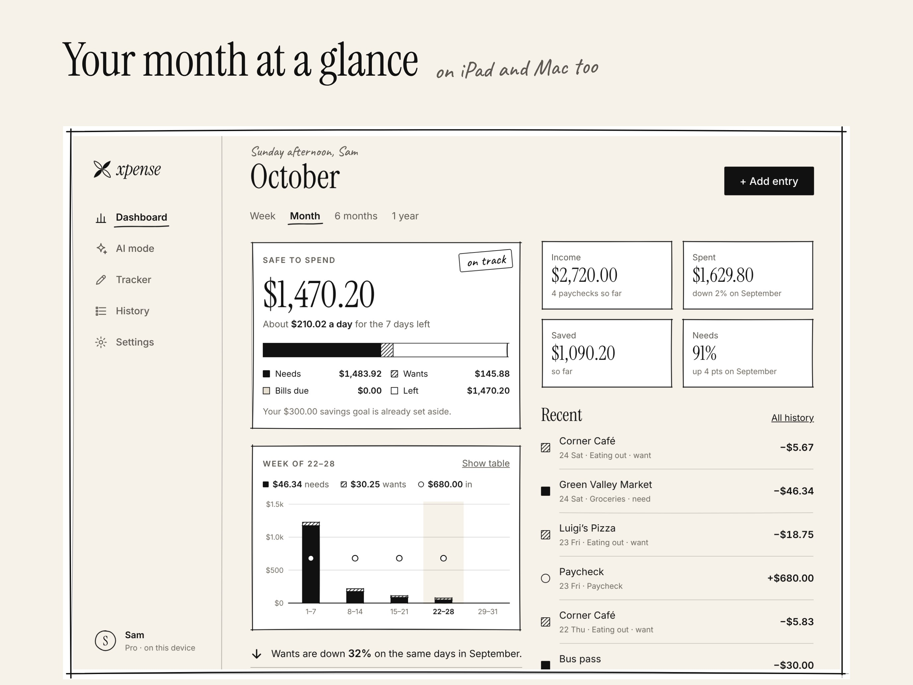

# Xpense

A pocket sketchbook for your money: an AI expense & income tracker for people who've just started earning (a first job, a part-time job next to school, saving up for something big) that helps them **spend on real needs, not wants**. Snap a receipt or bill and AI turns it into entries, each line sorted into a need or a want; the dashboard shows what's safe to spend after rent, bills and saving.

<p>
  
  
  
</p>
<p></p>

## Features

| | Free | Pro |
|---|---|---|
| Expense & income tracker, history, search, need/want tagging (free on-device rules) | ✓ | ✓ |
| Dashboard chart of needs, wants and income | Week & month | + 6 months, 1 year, spending by category |
| Safe to spend, Face ID lock, sync across devices | ✓ | ✓ |
| Repeating paychecks & bills (rent, phone, subscriptions) | up to 3 | unlimited |
| **AI receipt & bill scanning** | 3 free scans | up to 300 a month |
| **AI "Should I buy this?"**: hours of work and the person's own budget this month | — | ✓ |
| **AI monthly review** with a safety score and 3 tips | — | ✓ |
| CSV export, your own categories | — | ✓ |

- **Design:** a sketchbook. Beige paper, white pages, black ink; Instrument Serif headings, Inter text and Caveat pencil notes. Frames, rules and underlines are drawn by a seeded "pen" (`shared/sketch.ts`) so they look hand-drawn but never move. Needs are solid ink, wants are hatched, income is an open ring, so nothing relies on colour. Always light. See the [brand guide](docs/brand/README.md).
- **Accounts:** Sign in with Apple or a 6-digit email code (Supabase). Signing in is required; each account has its own database on the device.
- **Sync:** local-first. Everything works offline in SQLite and syncs through one row-level-secured Supabase table; the newest edit wins. Receipt photos stay on the device that took them.
- **Every device:** iPhone, iPad and Apple silicon Mac (one build), plus Android. On wide screens the tabs become a sidebar and the dashboard has two columns.
- **Website:** the AI server also serves the home page, privacy policy, terms and support page.

## How it works

```
Phone / iPad / Mac (Expo app)                     Cloudflare Worker (worker/)             Anthropic API
 photo ─ resize ≤1568px JPEG ─ POST /v1/scan ───► checks sign-in token, Pro / trial ───► claude-haiku-5-5
 SQLite (this account's copy)  ◄──────────────── schema-validated JSON ◄─────────────── structured output
   │  ▲  sync: changed rows up, newer rows down    also serves / /privacy /terms /support
   ▼  │                                            and deletes accounts (POST /v1/account/delete)
 Supabase: Auth (Apple, email code) + `records` table (row-level security)
 RevenueCat SDK (appUserID = account ID) ──────► RevenueCat REST (is this account Pro?)
```

- **AI model:** Claude Haiku 5.5 at **max effort** with structured outputs, about **$0.002–0.008 per receipt**; answers often take 10–60 seconds. The Worker starts replying at once and sends a space every 10 seconds while Claude thinks, because iPhones drop requests that go quiet for 60 seconds.
- **"Should I buy this?" knows the budget:** the app sends a few numbers about this month (safe to spend, days left, pay per hour, savings goal and what it's for, wants so far), never the entries themselves.
- **The API key never ships in the app.** The Worker verifies the Supabase access token (JWKS, or the legacy JWT secret), checks Pro with RevenueCat for that account, and applies trial, fair-use and burst limits. It stores no photos or results.
- **Sync** (`src/db/sync.ts`): each row has `updated_at` and a `dirty` flag; deletions leave a marker in `sync_deletes`. A sync pulls everything the server got since the last look (with a 5-minute overlap), applies it unless the local row is newer or deleted here, then pushes. Repeating entries use the id `rule:date`, so two devices booking the same paycheck agree. The server's trigger ignores an older edit that arrives late. `src/db/__tests__/sync.test.ts` runs two simulated devices against a fake server.

## Project layout

```
src/app/              screens (Expo Router): sign-in, email-code, onboarding, (tabs)/index | ai | tracker |
                      history, scan-review, transaction/[id], settings, paywall
src/components/       sketch.tsx (frames, rules, hatching, marks, stamps), ui.tsx (design system), brand,
                      illustrations, tab bar / sidebar, ProgressChart, money widgets, pickers
src/theme/tokens.ts   colours, fonts, type scale, wide-screen breakpoint
src/db/               SQLite schema + migrations, repositories, live queries, sync engine + provider
src/lib/              auth (Supabase), budget math, receipt splitting, categorize rules, AI client, Pro
shared/               zod schemas and the sketch pen, shared by the app, the Worker and the scripts
supabase/schema.sql   the synced table, its row-level security and last-edit-wins trigger
worker/               Cloudflare Worker (AI proxy, sign-in check, accounts, website) + tests
worker/public/        the website's fonts and app pictures
assets/               app icon (xpense.icon for iOS 26, PNGs for Android/splash), logo SVGs
scripts/              preflight check, demo launcher, brand, web-font and App Store image generators
docs/                 privacy policy, terms, support page, brand guide, App Store listing kit
LAUNCH.md             step-by-step guide to publishing
```

## Run it locally

Requirements: Node 20+ on your computer and the free **Expo Go** app on your phone (App Store or Google Play).

```bash
npm install
npm run demo            # then scan the QR code: iPhone Camera app, or "Scan QR code" in Expo Go on Android
```

`npm run demo` opens the app in Expo Go with **sample AI answers**. Until Supabase is set up, development builds offer **Try it without an account**: a local preview account that doesn't sync.

- **Same Wi-Fi:** the phone and the computer must be on the same Wi-Fi. If the phone can't connect, use `npm run demo -- --tunnel`.
- **Realistic data:** **Settings → Developer → Load sample data** adds about 3 months of a first job, living alone; **Simulate Pro** unlocks the Pro screens.
- **iPad layout in a browser:** `EXPO_PUBLIC_API_URL=demo npx expo start --web`, then make the window wider than 768 px.
- **Real sign-in, sync and AI:** once Supabase and the AI server are set up ([LAUNCH.md](LAUNCH.md), steps 3–4), run `npx expo start --go`. Sign in with Apple needs a development or TestFlight build; the email code works in Expo Go.
- **What Expo Go can't show:** real purchases, Sign in with Apple and the app's own icon. Use a development build for those.

Checks:

```bash
npm run typecheck && npm run lint && npm test     # app (includes the two-device sync tests)
cd worker && npm install && npm test              # AI Worker and website
```

## Publish to the App Store

**[LAUNCH.md](LAUNCH.md)** is the step-by-step guide, from opening the accounts to pressing Submit:

- **Supabase:** run `supabase/schema.sql`, turn on Apple and email-code sign-in, connect an email sender.
- **Listing text:** [`docs/app-store/listing.md`](docs/app-store/listing.md) has every App Store Connect field ready to paste, including privacy answers and review notes.
- **Images:** `docs/app-store/screenshots/` holds five 6.9" iPhone and two 13" iPad screenshots; `docs/app-store/iap-review.jpg` is the subscription review screenshot. `npm run store:screenshots` regenerates them, and the website's pictures, from the web preview.
- **Preflight:** `npm run preflight` checks the config, Supabase and the live server; `-- --ai` also signs in with a real email code and reads a sample receipt.

## Running costs

| Item | Cost |
|---|---|
| Apple Developer Program | $99 / year |
| Claude Haiku 5.5 at max effort | ≈ $0.002–0.008 per receipt scan, ≈ $0.001–0.003 per buy check or review |
| Cloudflare Workers Paid | $5 / month. The free plan's 10 ms of CPU per request is less than one streamed AI answer needs (measured 10–80 ms), and it allows only 1,000 usage-counter writes a day |
| Supabase | free plan to start (50,000 monthly users; idle free projects pause); Pro is $25 / month |
| Domain + Resend (sign-in emails) | about $10 / year; Resend is free for 3,000 emails a month |
| RevenueCat | free tier for small apps (check current pricing) |

A heavy Pro user (60 scans a month) costs about **$0.10–0.50/month** in AI. The Pro fair-use caps cap your worst case: an extreme user who maxes out all three caps (300 scans, 300 checks, 30 reviews) could cost up to about $3.40 a month. Lower `PRO_MONTHLY_SCANS`, `PRO_MONTHLY_CHECKS` or `PRO_MONTHLY_REVIEWS` in `worker/wrangler.toml` for a tighter ceiling, and change `PRO_MONTHLY_SCANS` in `src/lib/config.ts` to match (`npm run preflight` checks that they agree). To go back to the cheapest setting, change `EFFORT` in `worker/src/ai/claude.ts` to `'low'`.

## Configuration reference

| Where | Key | What |
|---|---|---|
| `app.json` → `extra` | `apiUrl` | Worker URL (`demo` = sample answers in dev builds) |
| | `supabaseUrl`, `supabaseKey` | Supabase project URL and **publishable** key (never the secret key) |
| | `revenueCatIosKey`, `revenueCatAndroidKey` | RevenueCat public SDK keys |
| | `privacyUrl`, `termsUrl`, `supportUrl` | Optional overrides. By default they are the AI server's `/privacy`, `/terms` and `/support` pages |
| `src/lib/config.ts` | `FREE_TRIAL_SCANS`, `PRO_MONTHLY_SCANS` | The numbers the app's copy quotes. Keep them equal to the server's |
| `worker/wrangler.toml` | `SUPABASE_URL` | The same project URL; sign-in tokens are checked against it |
| | `OWNER_NAME`, `CONTACT_EMAIL`, `GOVERNING_LAW`, `LAST_UPDATED` | Filled into the policy and support pages |
| | `APP_STORE_URL`, `PLAY_STORE_URL` | Optional. Download buttons on the website |
| | `FREE_TRIAL_SCANS`, `PRO_MONTHLY_SCANS`, `PRO_MONTHLY_CHECKS`, `PRO_MONTHLY_REVIEWS` | Trial size and Pro fair-use caps |
| Worker secrets | `ANTHROPIC_API_KEY`, `REVENUECAT_SECRET_KEY` (V1 secret), `SUPABASE_SECRET_KEY` | Set with `npx wrangler secret put`. Never commit these. Older Supabase projects that still sign tokens with a shared secret also need `SUPABASE_JWT_SECRET` |

| Script | What it does |
|---|---|
| `npm run demo` | Runs the app in Expo Go with sample AI answers |
| `npm run preflight` | Checks launch readiness. Add `-- --ai` to also test sign-in and a real AI scan |
| `npm run store:check` | Checks the listing text against App Store Connect's limits |
| `npm run store:screenshots` | Regenerates the App Store screenshots and the website's pictures from the web preview |
| `npm run brand` | Regenerates the logo, icon and splash files |
