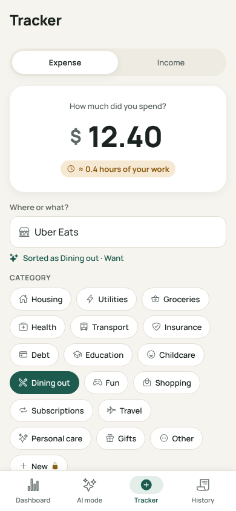
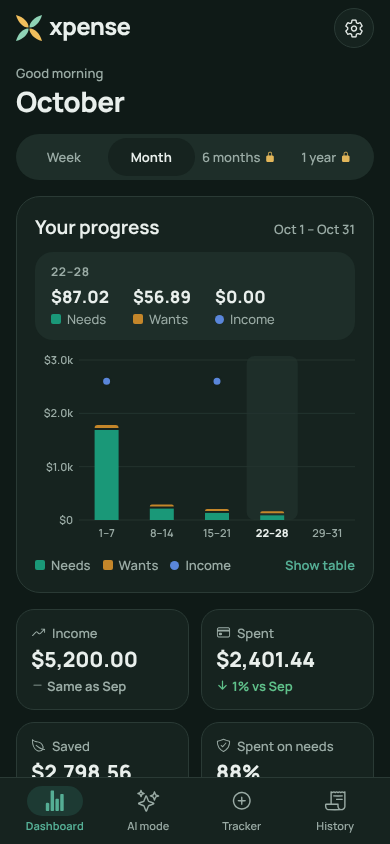

# Xpense

An AI expense & income tracker that helps people **spend on real needs, not wants**.
Snap a receipt or bill and AI turns it into categorized expenses. Each line is sorted into a need or a want, and the dashboard shows how much is safe to spend.

<p>
  
  
  
  
  
  
</p>

## Features

| | Free | Pro |
|---|---|---|
| Expense & income tracker, history, search, need/want tagging (free on-device rules) | ✓ | ✓ |
| Dashboard progress chart | Week & month | + 6 months, 1 year, spending by category |
| Safe-to-spend shield, Face ID lock, delete all data | ✓ | ✓ |
| Repeating income & bills (salary, rent, subscriptions) | up to 3 | unlimited |
| **AI receipt & bill scanning** | 3 free scans | up to 300 a month |
| **AI "Should I buy this?"**: hours of work, % of safe-to-spend, a cheaper alternative | — | ✓ |
| **AI monthly review** with a safety score and 3 tips | — | ✓ |
| CSV export, custom categories | — | ✓ |

- **Design:** "safe, calm, conserving".
  - **Logo:** four leaves crossing in an X. Needs are on one diagonal, wants on the other.
  - **Look:** evergreen on parchment, with Manrope type and light and dark themes.
  - **Accessibility:** chart and text colours were checked for colour blindness and WCAG AA contrast.
  - See the [brand guide](docs/brand/README.md).
- **Privacy:** all budgeting data stays **on the phone** in SQLite. There is no account and no bank login. AI features ask for consent first.

## How it works

```
Phone (Expo app)                              Cloudflare Worker (worker/)          Anthropic API
 photo ─ resize ≤1568px JPEG ─ POST /v1/scan ─► checks Pro / trial ─ messages.stream ► claude-haiku-5-5
 SQLite: all user data stays here   ◄────────── schema-validated JSON ◄──────────────── structured output
 RevenueCat SDK (buy / restore Pro) ─────────► RevenueCat REST (is this install Pro?)
```

- **AI model:** Claude Haiku 5.5 at **max effort** (it thinks as hard as it can before answering) with structured outputs. That costs about **$0.002–0.008 per receipt**, and answers often take 10–60 seconds.
- **Slow answers stay connected:** the Worker starts replying at once and sends a space every 10 seconds while Claude thinks, because iPhones drop requests that go quiet for 60 seconds. AI errors after that point arrive in the JSON body.
- **Your API key never ships in the app.** The Worker holds it, checks Pro status with RevenueCat on the server (so a modified app can't unlock AI), and applies trial, fair-use and burst limits. It stores no photos or results. If RevenueCat can't be reached, free trial scans keep working and Pro features wait.
- **No separate website:** the Worker also serves the privacy policy, terms, support page and a small home page.
- **Anonymous by default:** a random install ID (shown in Settings → About → Support ID) is the RevenueCat app user ID and the key for usage counters.

## Project layout

```
src/app/              screens (Expo Router): (tabs)/index | ai | tracker | history, scan-review,
                      transaction/[id], settings, paywall, onboarding
src/components/       design system (ui, brand, illustrations, tab bar, toasts), ProgressChart,
                      money widgets, date and category pickers
src/theme/tokens.ts   colours (light + dark), Manrope type scale, spacing, elevation
src/db/               SQLite schema + migrations, repositories, live queries
src/lib/              budget math, receipt splitting, categorize rules, AI client, Pro (RevenueCat)
shared/schemas.ts     zod schemas shared by the app and the Worker
worker/               Cloudflare Worker (AI proxy, entitlements) + tests
assets/               app icon (xpense.icon for iOS 26, PNGs for Android/splash), logo SVGs
scripts/              preflight check, demo launcher, brand and App Store image generators
docs/                 privacy policy, terms, support page, brand guide, App Store listing kit
LAUNCH.md             step-by-step guide to publishing
```

## Run it locally

Requirements: Node 20+ on your computer and the free **Expo Go** app on your phone (App Store or Google Play).

```bash
npm install
npm run demo            # then scan the QR code: iPhone Camera app, or "Scan QR code" in Expo Go on Android
```

`npm run demo` opens the app in Expo Go with **sample AI answers**, so AI mode works before the AI server is deployed. Any photo you scan comes back as the same sample receipt.

- **Same Wi-Fi:** the phone and the computer must be on the same Wi-Fi. If the phone can't connect, use `npm run demo -- --tunnel`.
- **Realistic data:** to fill the app with data, use **Settings → Developer**. **Load sample data** adds about 3 months of entries, and **Simulate Pro** unlocks the Pro screens.
- **Real AI:** once the AI server is deployed ([LAUNCH.md](LAUNCH.md), step 3), run `npx expo start --go` instead. Keep `--go`: the project includes `expo-dev-client`, so plain `npx expo start` expects a development build rather than Expo Go.
- **What Expo Go can't show:** real purchases and the app's own icon. Use a development build for those.

Checks:

```bash
npm run typecheck && npm run lint && npm test     # app
cd worker && npm install && npm test              # AI Worker
```

## Brand & design

The [brand guide](docs/brand/README.md) covers the logo, colours, type, app icons and tone of voice.

- **Logo and icons:**
  - `scripts/brand/mark.mjs` holds the logo geometry, and `npm run brand` regenerates every logo, icon and splash file from it.
  - On iOS 26 the app icon is an Icon Composer bundle (`assets/xpense.icon`). Needs and wants are separate glass layers, so the icon works in light, dark and tinted modes.
- **Theme:** colours, the type scale and spacing live in `src/theme/tokens.ts`. Screens build from the primitives in `src/components/ui.tsx` rather than raw styles.

## Publish to the App Store

**[LAUNCH.md](LAUNCH.md)** is the step-by-step guide, from opening the accounts to pressing Submit. Most of the work is already in the repo:

- **AI server pages.** The AI server also hosts the privacy policy, terms and support pages that App Store Connect asks for: `/privacy`, `/terms`, `/support` and a home page. Their text comes from `docs/*.md`, with your details from `worker/wrangler.toml`.
- **Listing text.** [`docs/app-store/listing.md`](docs/app-store/listing.md) has every App Store Connect field ready to paste: name, subtitle, description, keywords, privacy answers, age rating, review notes and the two subscriptions.
- **Images.** `docs/app-store/screenshots/` holds five 6.9" iPhone screenshots, and `docs/app-store/iap-review.jpg` is the subscription review screenshot.
- **Preflight.** `npm run preflight` checks your config and the live server, including whether Anthropic and RevenueCat accept your keys, before you build.

## Running costs

| Item | Cost |
|---|---|
| Apple Developer Program | $99 / year |
| Claude Haiku 5.5 at max effort | ≈ $0.002–0.008 per receipt scan, ≈ $0.001–0.003 per buy check or review |
| Cloudflare Workers Paid | $5 / month. The free plan's 10 ms of CPU per request is less than one streamed AI answer needs (measured 10–80 ms), and it allows only 1,000 usage-counter writes a day |
| RevenueCat | free tier for small apps (check current pricing) |

A heavy Pro user (60 scans a month) costs about **$0.10–0.50/month** in AI. These are estimates: at max effort the thinking length varies by receipt, so check real costs in the Anthropic Console after launch.

The Pro fair-use caps cap your worst case. An extreme user who maxes out all three caps (300 scans, 300 checks, 30 reviews) could cost up to about $3.40 a month. That is more than the $2.99 monthly price after Apple's cut. Lower `PRO_MONTHLY_SCANS`, `PRO_MONTHLY_CHECKS` or `PRO_MONTHLY_REVIEWS` in `worker/wrangler.toml` if you want a tighter ceiling. The terms page picks up the new numbers by itself. Change `PRO_MONTHLY_SCANS` in `src/lib/config.ts` to match, because the app quotes it; `npm run preflight` checks that the two agree. To go back to the cheapest setting, change `EFFORT` in `worker/src/ai/claude.ts` to `'low'`.

## Configuration reference

| Where | Key | What |
|---|---|---|
| `app.json` → `extra` | `apiUrl` | Worker URL (`demo` = sample answers in dev builds) |
| | `revenueCatIosKey`, `revenueCatAndroidKey` | RevenueCat public SDK keys |
| | `privacyUrl`, `termsUrl`, `supportUrl` | Optional overrides. By default they are the AI server's `/privacy`, `/terms` and `/support` pages |
| `src/lib/config.ts` | `FREE_TRIAL_SCANS`, `PRO_MONTHLY_SCANS` | The numbers the app's copy quotes. Keep them equal to the server's |
| `worker/wrangler.toml` | `OWNER_NAME`, `CONTACT_EMAIL`, `GOVERNING_LAW`, `LAST_UPDATED` | Filled into the policy and support pages |
| | `APP_STORE_URL` | Optional. Adds a download button to the server's home page |
| | `FREE_TRIAL_SCANS`, `PRO_MONTHLY_SCANS`, `PRO_MONTHLY_CHECKS`, `PRO_MONTHLY_REVIEWS` | Trial size and Pro fair-use caps |
| Worker secrets | `ANTHROPIC_API_KEY`, `REVENUECAT_SECRET_KEY` (a V1 secret key) | Set with `npx wrangler secret put`. Never commit these |

| Script | What it does |
|---|---|
| `npm run demo` | Runs the app in Expo Go with sample AI answers |
| `npm run preflight` | Checks launch readiness. Add `-- --ai` to also test a real AI scan |
| `npm run store:check` | Checks the listing text against App Store Connect's limits |
| `npm run store:screenshots` | Regenerates the App Store screenshots from the web preview (see the script for how) |
| `npm run brand` | Regenerates the logo, icon and splash files |
