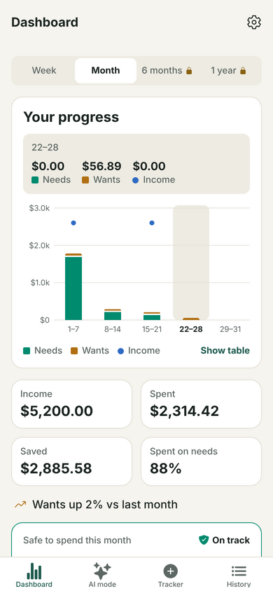
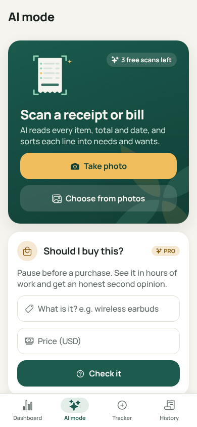
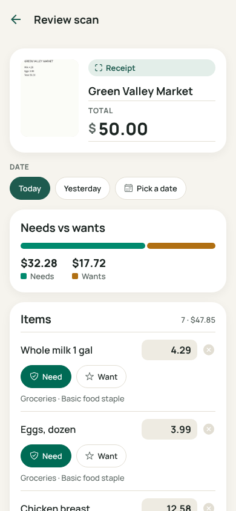
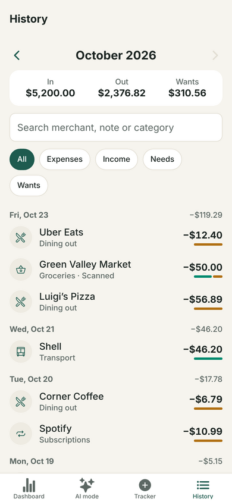

# Xpense

An AI expense & income tracker that helps people **spend on real needs, not wants**.
Snap a receipt or bill and AI turns it into categorized expenses. Each line is sorted into a need or a want, and the dashboard shows how much is safe to spend.

<p>
  
  
  
  
</p>

## Features

| | Free | Pro |
|---|---|---|
| Expense & income tracker, history, search, need/want tagging (free on-device rules) | ✓ | ✓ |
| Dashboard progress chart | Week & month | + 6 months, 1 year, spending by category |
| Safe-to-spend shield, Face ID lock, delete all data | ✓ | ✓ |
| Repeating income & bills (salary, rent, subscriptions) | up to 3 | unlimited |
| **AI receipt & bill scanning** | 3 free scans | unlimited (fair use 300/month) |
| **AI "Should I buy this?"**: hours of work, % of safe-to-spend, a cheaper alternative | — | ✓ |
| **AI monthly review** with a safety score and 3 tips | — | ✓ |
| CSV export, custom categories | — | ✓ |

- **Design:** "safe, calm, conserving": evergreen for needs and trust, amber for wants, a shield-and-leaf mark, light and dark themes. The chart colors pass a colorblind-safety and contrast check.
- **Privacy:** all budgeting data stays **on the phone** in SQLite. There is no account and no bank login. AI features ask for consent first.

## How it works

```
Phone (Expo app)                              Cloudflare Worker (worker/)          Anthropic API
 photo ─ resize ≤1568px JPEG ─ POST /v1/scan ─► checks Pro / trial ─ messages.parse ─► claude-haiku-5-5
 SQLite: all user data stays here   ◄────────── schema-validated JSON ◄──────────────── structured output
 RevenueCat SDK (buy / restore Pro) ─────────► RevenueCat REST (is this install Pro?)
```

- **AI model:** Claude Haiku 5.5 at **max effort** (it thinks as hard as it can before answering) with structured outputs. That costs about **$0.002–0.008 per receipt**, and answers often take 10–60 seconds.
- **Slow answers stay connected:** the Worker starts replying at once and sends a space every 10 seconds while Claude thinks, because iPhones drop requests that go quiet for 60 seconds. AI errors after that point arrive in the JSON body.
- **Your API key never ships in the app.** The Worker holds it, checks Pro status with RevenueCat on the server (so a modified app can't unlock AI), and applies trial, fair-use and burst limits. It stores no photos or results.
- **Anonymous by default:** a random install ID (shown in Settings → About → Support ID) is the RevenueCat app user ID and the key for usage counters.

## Project layout

```
src/app/              screens (Expo Router): (tabs)/index | ai | tracker | history, scan-review,
                      transaction/[id], settings, paywall, onboarding
src/components/       design-system pieces, ProgressChart (react-native-svg), money widgets
src/db/               SQLite schema + migrations, repositories, live queries
src/lib/              budget math, receipt splitting, categorize rules, AI client, Pro (RevenueCat)
shared/schemas.ts     zod schemas shared by the app and the Worker
worker/               Cloudflare Worker (AI proxy, entitlements) + tests
docs/                 privacy policy, terms of use, screenshots
```

## Run it locally

Requirements: Node 20+ and the **Expo Go** app on your phone.

```bash
npm install
npx expo start          # scan the QR code with Expo Go (iPhone camera or Android Expo Go)
```

To try AI mode before deploying anything, create `.env.local` with:

```
EXPO_PUBLIC_API_URL=demo
```

In development builds this returns sample AI answers. To see the app full of realistic data, use **Settings → Developer**: **Load sample data** fills about 3 months of entries, and **Simulate Pro** unlocks the Pro screens.

Checks:

```bash
npm run typecheck && npm run lint && npm test     # app
cd worker && npm install && npm test              # AI Worker
```

## 1. Deploy the AI server (Cloudflare Worker)

1. Create an Anthropic API key at [console.anthropic.com](https://console.anthropic.com). Set a **monthly spend limit** there; it is your hard cost cap.
2. Deploy the Worker:
   ```bash
   cd worker
   npm install
   npx wrangler login
   npx wrangler kv namespace create USAGE        # paste the printed id into wrangler.toml
   npx wrangler secret put ANTHROPIC_API_KEY
   npx wrangler secret put REVENUECAT_SECRET_KEY # from step 2 below; until then free users get only the 3 trial scans
   npx wrangler deploy                           # prints https://xpense-ai.<you>.workers.dev
   curl https://xpense-ai.<you>.workers.dev/health   # {"ok":true}
   ```
3. Put the Worker URL in `app.json` → `expo.extra.apiUrl`.

## 2. Set up Pro subscriptions

1. **App Store Connect:**
   - Join the Apple Developer Program ($99/year), sign the **Paid Apps Agreement** and add your tax and banking details.
   - Create the app with bundle ID `com.axtonnnn.xpense` (or change `ios.bundleIdentifier` in `app.json` to your own).
   - Add a subscription group **Xpense Pro** with two products: monthly ($2.99) and yearly ($19.99, with a 7-day free-trial introductory offer).
   - Optional: join the [App Store Small Business Program](https://developer.apple.com/app-store/small-business-program/) to pay a 15% commission instead of 30%.
2. **RevenueCat** ([app.revenuecat.com](https://app.revenuecat.com)):
   - Create a project and add the iOS app, connecting App Store Connect as RevenueCat describes.
   - Import both products, attach them to an entitlement named exactly **`pro`**, and add them as monthly and annual packages to the **default offering**.
   - Copy the **public iOS SDK key** into `app.json` → `expo.extra.revenueCatIosKey`.
   - Copy a **secret API key** into the Worker with `npx wrangler secret put REVENUECAT_SECRET_KEY`.
3. Host `docs/privacy-policy.md` and `docs/terms.md` (GitHub Pages works), fill in the bracketed placeholders, and put the URLs in `app.json` → `expo.extra.privacyUrl` / `termsUrl`. The paywall and Settings link to them, as Apple requires.

## 3. Build and submit with EAS

```bash
npx eas-cli@latest login
npx eas-cli@latest init                                   # links the project (adds a projectId)
npx eas-cli@latest build -p ios --profile development     # optional: test real sandbox purchases on your phone
npx eas-cli@latest build -p ios --profile production
npx eas-cli@latest submit -p ios
```

No Mac is needed: EAS builds and signs in the cloud. Real purchases can't be tested in Expo Go (RevenueCat runs in preview mode there). Use the **development** build with an App Store sandbox tester.

### App Store checklist

- **Category:** Finance.
- **Screenshots:** take them on a 6.9" iPhone or the simulator. The images in `docs/screenshots` are web previews only.
- **App Privacy questionnaire:** these answers are a conservative suggestion; review them against what you actually ship. Nothing is used for tracking or ads.

  | Data type | Purpose | Linked to user? |
  |---|---|---|
  | Photos (receipt scans) | App Functionality | No |
  | Other Financial Info (item prices checked, monthly totals for the review) | App Functionality | No |
  | Identifiers → User ID (anonymous install ID) | App Functionality | Yes |
  | Purchases → Purchase History (via RevenueCat) | App Functionality | Yes |

- **Review notes:**
  - AI features ask for consent first (guideline 5.1.2(i)). Free users get 3 AI scans, and Pro can be tested with a sandbox account.
  - All budgeting data is stored on the device.
- **Export compliance:** `usesNonExemptEncryption: false` is already set (the app only uses standard HTTPS).

## Running costs

| Item | Cost |
|---|---|
| Apple Developer Program | $99 / year |
| Claude Haiku 5.5 at max effort | ≈ $0.002–0.008 per receipt scan, ≈ $0.001–0.003 per buy check or review |
| Cloudflare Workers + KV | free tier covers 100k requests/day |
| RevenueCat | free tier for small apps (check current pricing) |

A heavy Pro user (60 scans a month) costs about **$0.10–0.50/month** in AI. These are estimates: at max effort the thinking length varies by receipt, so check real costs in the Anthropic Console after launch.

The Pro fair-use caps cap your worst case. An extreme user who maxes out all three caps (300 scans, 300 checks, 30 reviews) could cost up to about $3.40 a month. That is more than the $2.99 monthly price after Apple's cut. Lower `PRO_MONTHLY_SCANS`, `PRO_MONTHLY_CHECKS` or `PRO_MONTHLY_REVIEWS` in `worker/wrangler.toml` if you want a tighter ceiling, and update `docs/terms.md` to match. To go back to the cheapest setting, change `EFFORT` in `worker/src/ai/claude.ts` to `'low'`.

## Configuration reference

| Where | Key | What |
|---|---|---|
| `app.json` → `extra` | `apiUrl` | Worker URL (`demo` = sample answers in dev builds) |
| | `revenueCatIosKey`, `revenueCatAndroidKey` | RevenueCat public SDK keys |
| | `privacyUrl`, `termsUrl` | Hosted policy pages |
| `worker/wrangler.toml` | `FREE_TRIAL_SCANS`, `PRO_MONTHLY_SCANS`, `PRO_MONTHLY_CHECKS`, `PRO_MONTHLY_REVIEWS` | Trial size and Pro fair-use caps |
| Worker secrets | `ANTHROPIC_API_KEY`, `REVENUECAT_SECRET_KEY` | Never commit these |
