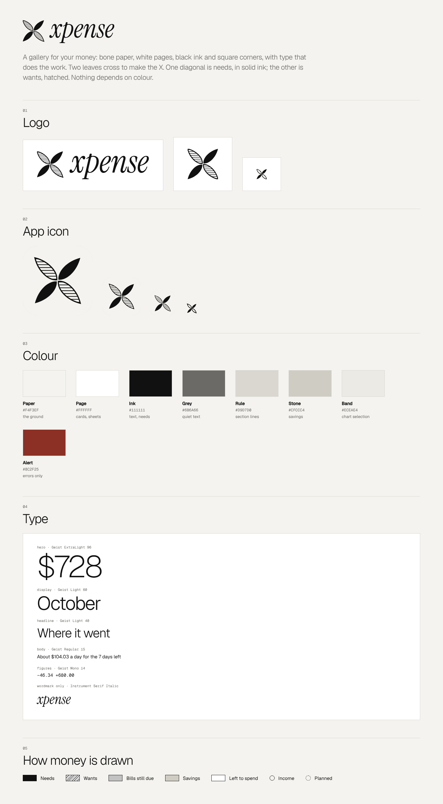

# Xpense brand



## The idea

Xpense is a gallery for your money: bone paper, white pages, black ink, square corners, and type that does the work. It's made for people on their first paychecks, so it should feel calm, structured and safe, like a well-kept plan, not like a bank.

Four slim leaves cross to make an **X**. One diagonal (**/**) is **needs**, in solid ink; the other (**\\**) is **wants**, hatched:

- the leaves stand for saving and growing,
- the X stands for Xpense,
- the crossing point is the choice the app helps you make.

The same rule runs through the whole app, so nothing depends on colour: **needs are solid ink, wants are hatched, bills still due are dotted, savings are stone, income is an open ring, and dashed means planned.** White is what's left to spend.

## Logo

| File | Use |
|---|---|
| `assets/brand/logo.svg` | Mark + "xpense" wordmark |
| `assets/brand/mark.svg` | The mark alone (avatars, small spaces) |
| `assets/brand/icon.svg` | The app icon as a vector |
| `worker/public/favicon.svg`, `apple-touch-icon.png` | The website's tab and home-screen icons |

The wordmark is **Instrument Serif Italic**, lowercase, the one serif in the whole system. In the SVGs it is converted to outlines, so the files don't need the font installed.

In the app, use the components from `src/components/brand.tsx` rather than images:

- `<Logo />`: the mark plus the wordmark. `mark={false}` shows the wordmark alone.
- `<LogoMark />`: the mark alone. From 48 px up the wants leaves are hatched; below that they are outlines, so the mark stays crisp.
- `<AppIcon />`: the rounded paper tile.

Rules:
- Keep clear space around the logo at least the width of one leaf.
- Don't use the mark below 16 px.
- Never swap the diagonals. Needs are always on the "/" diagonal.
- Ink on paper only. No colours, no gradients.

## Colour

Tokens live in `src/theme/tokens.ts`. The app is always light.

| Token | Hex | Used for |
|---|---|---|
| Paper | `#F4F3EF` | The ground every screen sits on |
| Page | `#FFFFFF` | Cards, sheets, fields |
| Ink | `#111111` | Text, lines, needs, buttons |
| Grey | `#6B6A66` | Quiet text |
| Rule | `#D9D7D0` | Lines between sections, outlines |
| Line | `#E4E2DC` | Lines between rows |
| Stone | `#CFCCC4` | Savings and money set aside |
| Band | `#ECEAE4` | The selected column in a chart |
| Alert | `#8C2F25` | Errors and "delete account" only |

Every text pair meets WCAG AA (4.5:1): grey on paper is 4.9:1.

## Type

Geist and Geist Mono for everything, Instrument Serif Italic only for the wordmark. All three are under the SIL Open Font License and load from `@expo-google-fonts`. Each weight is its own family, so pick one through `fonts.*` or `<AppText weight="…">`, never with `fontWeight`.

| Style | Font | Size / line | Use |
|---|---|---|---|
| `hero` | Geist ExtraLight | 96 / 96 | The one big number on a screen (safe to spend) |
| `display` | Geist Light | 60 / 60 | Screen titles |
| `headline` | Geist Light | 40 / 44 | Big statements ("You did it.") |
| `title` | Geist Regular | 22 / 28 | Section titles |
| `number` | Geist Light | 26 / 32 | Amounts in figures |
| `body` | Geist Regular | 15 / 22 | Text |
| `caption`, `small` | Geist Regular | 13 / 18, 12 / 16 | Secondary text |
| `mono` | Geist Mono | 14 / 20 | Figures in lists |
| `index` | Geist Mono | 11 / 16 | Section numbers: 01, 02… |

Large type is tracked tight (−5% at hero size), small type is left alone.

## Layout and motion

- Phone screens have 24 pt margins; sections sit 40 pt apart with a rule between, each numbered in Geist Mono.
- Corners are square. The only round things are rings (income) and the app icon.
- **Primary button:** an ink plate. **Secondary:** an ink outline. **Field:** a label and a line that grows from the left when focused.
- Motion is small and quick, one curve for everything (`cubic-bezier(0.2, 0, 0, 1)`): numbers count up, bars fill, rows fade in, sheets rise. Reduce Motion turns slides into fades. See `motion` in `src/theme/tokens.ts`.

## App icon

| Platform | Source | Configured in `app.json` |
|---|---|---|
| iOS 26+ | `assets/xpense.icon`, an Icon Composer bundle: needs and wants are separate layers on a paper fill | `ios.icon` |
| Older iOS, App Store | `assets/images/icon.png` (1024 px, no transparency) | `icon` |
| Android | `android-icon-foreground.png` (leaves at 72% so they stay inside the safe zone), `android-icon-background.png` and `android-icon-monochrome.png` (Android 13 themed icons) | `android.adaptiveIcon` |
| Splash | `splash-icon.png` on paper | `expo-splash-screen` plugin |
| Web | `favicon.png` | `web.favicon` |

## Regenerating the files

```bash
npm run brand                                   # logos, icons, splash, website icons and this page's brand sheet
CHROME_PATH=/path/to/chromium npm run brand     # with any Chromium instead of Google Chrome
python3 scripts/brand/web-fonts.py              # the website's fonts (needs fonttools and brotli)
```

The geometry is in `scripts/brand/mark.mjs`. The in-app `<LogoMark />` and the website draw the same geometry; if you change a number in `mark.mjs`, change it in `src/components/brand.tsx` and `worker/src/pages.ts` too.

## Voice

The app talks like a friend who's good with money: calm, specific, never shaming. It states the fact, then gives one small step.

- "Wants are up 12% on the same days in September. A good week to pause the extras."
- "Sleep on it" rather than "Don't buy this".
- It says **needs** and **wants**, never "good" or "bad" spending.
- It says "the AI", never the name of the company behind it. (The privacy policy and App Review notes name the provider, as Apple requires.)
